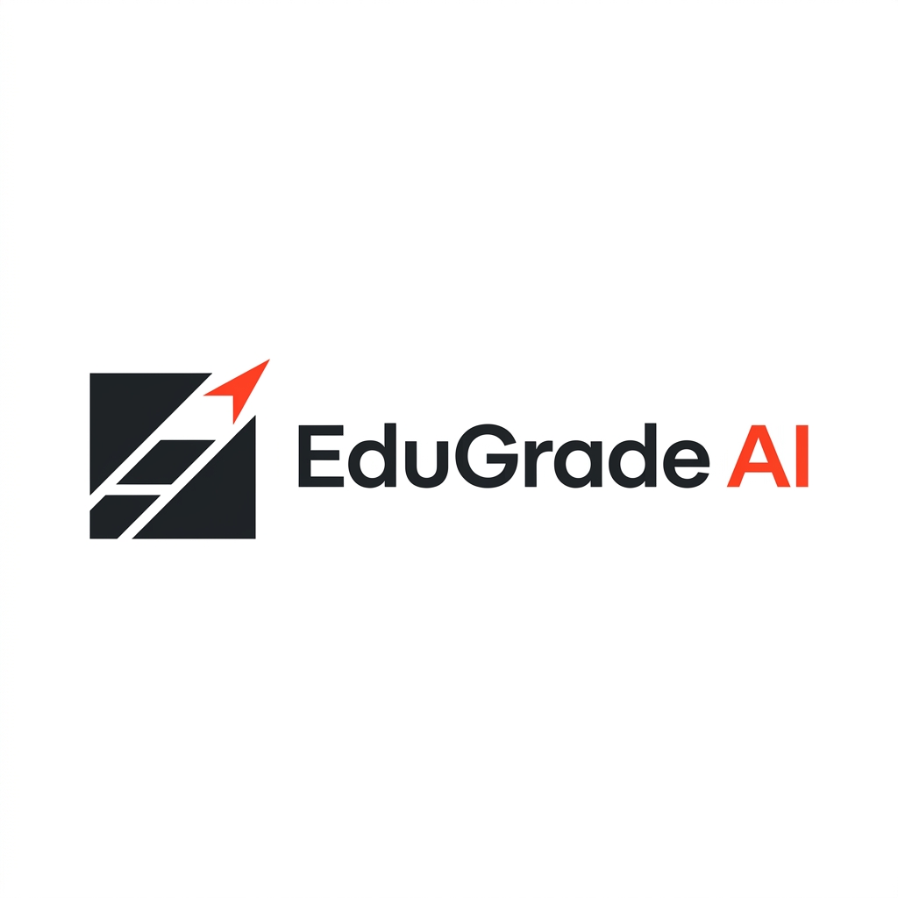

<div align="center">

<!-- Project Logo -->
<p align="center">
  
</p>

<!-- Animated SVG Hero Banner -->
<p align="center">
  
</p>

<!-- Verified Badge Matrix (100% Reliable Render) -->
<p align="center">
  
  
  
  
</p>

<p align="center">
  
  
  
  
  
  
</p>

<!-- Live Pulse Telemetry Indicators -->
<p align="center">
  
  
  
  
  
</p>

</div>

---

## ⚡ Executive Summary

**EduGrade AI** is an institutional academic intelligence platform, credit-weighted CGPA/SGPA engine, stochastic milestone digital twin, campus placement readiness auditor, and AI mentor.

Engineered specifically for autonomous engineering institutions operating under the **UGC / Anna University Choice Based Credit System (CBCS)**, EduGrade AI embeds the exact curriculum of **K.S. Rangasamy College of Technology (Autonomous)** for the **B.Tech Computer Science & Business Systems (Regulation 2022, 2024–2028 batch, 164 Total Credits)**.

Built with a unified, high-performance **Django REST Backend** and an interactive, real-time **ReactPy Python Frontend** communicating over persistent WebSocket channels, EduGrade AI eliminates context switching between static spreadsheets, marks estimation calculators, and placement circulars.

```text
       ┌────────────────────────────────────────────────────────┐
       │   Student Enters Result / CSV / Target CGPA / Backlog  │
       └───────────────────────────┬────────────────────────────┘
                                   │ (WebSocket / HTTP REST)
                                   ▼
┌──────────────────────────────────────────────────────────────────────────────┐
│                    EduGrade AI Core Computation Engine                       │
├───────────────────────────────┬───────────────────────────────┬──────────────┤
│    CBCS Regulation Engine     │   Monte Carlo Digital Twin    │  Placement   │
│  40% CIA + 60% External Exam  │ 100 Stochastic Future Paths   │   Matcher    │
│  Grade-to-Point (O:10 - RA:0) │ P10, P50, P90 CGPA Forecasts  │ 6 Corporate  │
│  Atomic Recalculation Engine  │ Next Best Move Impact Ranking │  Thresholds  │
└───────────────────────────────┴───────────────────────────────┴──────────────┘
                                   │
                                   ▼
       ┌────────────────────────────────────────────────────────┐
       │       Verifiable Transcripts & Grounded AI Advice      │
       │  • HMAC-SHA256 QR Digital Verification Gateway         │
       │  • Context-Grounded Advisor with English Voice Support │
       └────────────────────────────────────────────────────────┘
```

---

## 🌟 Core Superpowers

<table>
  <tr>
    <td width="50%" valign="top">
      <h3>🎯 1. Academic Digital Twin (Future Lab)</h3>
      <p>Simulates 100 stochastic academic futures across remaining semesters using student effort parameters (<em>lower</em>, <em>steady</em>, <em>intense</em>). Projects final graduation CGPA distributions, statistical confidence intervals (<strong>P10</strong>, <strong>P50</strong>, <strong>P90</strong>), and company unlock odds.</p>
    </td>
    <td width="50%" valign="top">
      <h3>📈 2. Next Best Move (Impact Ranking)</h3>
      <p>Computes the exact mathematical leverage of every course. Ranks active backlogs and upcoming electives by the net CGPA boost they yield upon clearance, showing students the highest return-on-effort path to placement eligibility.</p>
    </td>
  </tr>
  <tr>
    <td width="50%" valign="top">
      <h3>📐 3. Deterministic Marks Target Bridge</h3>
      <p>Reverse-calculates exact semester end exam scores out of 60 needed to hit <code>O</code>, <code>A+</code>, or <code>A</code> grades based on continuous internal marks out of 40. Alerts when target grades are mathematically unattainable before exam week.</p>
    </td>
    <td width="50%" valign="top">
      <h3>💼 4. Placement Eligibility Matrix</h3>
      <p>Audits student records in real time against corporate recruiting criteria (Google, Microsoft, Zoho, TCS Digital, Infosys, Amazon AWS). Evaluates CGPA cutoffs, standing arrears, and maps course credits to industry skill domains.</p>
    </td>
  </tr>
  <tr>
    <td width="50%" valign="top">
      <h3>🤖 5. Grounded AI Advisor</h3>
      <p>Context-aware conversational mentor powered by Groq Cloud (Llama 3.3 70B). Grounded in the student's real semester results, active backlogs, and target CGPA. Fully supports voice speech-to-text and audio synthesis in <strong>English</strong>.</p>
    </td>
    <td width="50%" valign="top">
      <h3>🛡️ 6. Cryptographically Verified Transcripts</h3>
      <p>Generates official self-reported PDF transcripts embedded with ReportLab HMAC-SHA256 verification QR codes. Public gateway at <code>/verify/&lt;token&gt;/</code> enables instant third-party validation while masking student PII.</p>
    </td>
  </tr>
</table>

---

## 🧭 Page Architecture & Component Inventory

EduGrade AI mounts 12 specialized pages inside a persistent **Swiss-Brutalist Layout** featuring a sticky sidebar with independent navigation scrolling:

<details>
<summary><b>🔍 Click to Expand: Complete 12-Page Breakdown</b></summary>

| # | Page Component | File Path | Functional Purpose |
| :-: | :--- | :--- | :--- |
| **1** | **Landing Page** | `ui/pages/landing.py` | Public storefront with system telemetry, live feature tabs, and 14-step automated presentation tour (`demo_tour.js`). |
| **2** | **Sign In Portal** | `ui/pages/auth_page.py` | Institutional authentication gateway with roll number/username login, 1-Click Demo login, and rate-limiting lockout protection. |
| **3** | **Sign Up Portal** | `ui/pages/auth_page.py` | New student registration capturing Full Name, Roll No, Department, Institution, and Semester. |
| **4** | **Executive Dashboard** | `ui/pages/student_dashboard.py` | Central command center showing Current CGPA, Latest SGPA, Credits, Arrears, SGPA bar chart, and Next Best Move banner. |
| **5** | **Results Ledger** | `ui/pages/results_page.py` | Multi-semester transcript manager with Single-Course CRUD drawer, **Delete Semester** button, bulk CSV import modal, and official PDF download. |
| **6** | **CGPA Planner** | `ui/pages/cgpa_planner.py` | Forward-looking simulator with target CGPA sliders, honors thresholds (Distinction ≥ 8.50), and semester-by-semester SGPA target allocators. |
| **7** | **Future Lab** | `ui/pages/future_lab.py` | Monte Carlo Digital Twin (100 runs), Next Best Move ranking, and Internal-to-External Marks Target Calculator. |
| **8** | **Placement Matrix** | `ui/pages/placement_page.py` | Live corporate cutoff comparison (CTC, Min CGPA, Max Arrears) and Academic Skill Radar scoring completed course credits. |
| **9** | **AI Academic Advisor** | `ui/pages/ai_advisor.py` | Contextually grounded chatbot with prompt chips, personalized advice, and English Speech-to-Text / Audio Synthesis. |
| **10**| **Curriculum & Regulations**| `ui/pages/regulations_page.py`| Authoritative institutional guide displaying the UGC 10-point scale and complete 8-semester syllabus for B.Tech CSBS (R2022). |
| **11**| **Institutional Profile**| `ui/pages/profile_page.py`| Student identity card with live profile edit mode, target CGPA adjustments, affiliation badges, and password change utility. |
| **12**| **My Journey & Badges** | `ui/pages/journey_page.py` | Gamified milestone roadmap tracking degree completion (164 credits) and unlocking 7 milestone achievement badges. |

</details>

---

## 🏛️ Regulation 2022 Curriculum (K.S. Rangasamy College of Technology)

The platform is pre-seeded with the authoritative **B.Tech CSBS (Regulation 2022)** curriculum:

```text
┌────────────────────────────────────────────────────────────────────────┐
│  K.S. RANGASAMY COLLEGE OF TECHNOLOGY (AUTONOMOUS), TIRUCHENGODE       │
│  DEPARTMENT OF COMPUTER SCIENCE & BUSINESS SYSTEMS (R2022, 2024–2028)  │
│  TOTAL DEGREE REQUIREMENT: 164 CREDITS • 10.0 CBCS GRADING SCALE       │
└────────────────────────────────────────────────────────────────────────┘
```

| Grade | Description | Grade Point | Assessment Range |
| :---: | :--- | :---: | :---: |
| **O** | Outstanding | **10.0** | 91 – 100 Marks |
| **A+** | Excellent | **9.0** | 81 – 90 Marks |
| **A** | Very Good | **8.0** | 71 – 80 Marks |
| **B+** | Good | **7.0** | 61 – 70 Marks |
| **B** | Above Average | **6.0** | 56 – 60 Marks |
| **C** | Satisfactory | **5.0** | 50 – 55 Marks |
| **RA / U** | Re-Appearance (Arrear) | **0.0** | < 50 Total or < 45 External |

$$\text{SGPA} = \frac{\sum_{i=1}^{n} (C_i \times GP_i)}{\sum_{i=1}^{n} C_i} \qquad\qquad \text{CGPA} = \frac{\sum_{j=1}^{m} (C_j \times GP_j)}{\sum_{j=1}^{m} C_j}$$

---

## 🚀 Quickstart Guide

### 1. Clone & Set Up Virtual Environment

```bash
# Clone the repository
git clone https://github.com/NAVEENKumar207/Edugrade-AI.git
cd Edugrade-AI

# Create and activate Python virtual environment
python -m venv venv
# Windows (PowerShell):
.\venv\Scripts\Activate.ps1
# Linux / macOS:
source venv/bin/activate

# Install all dependencies
pip install -r requirements.txt
```

### 2. Configure Environment Variables

```bash
# Copy example configuration
cp .env.example .env
```

| Environment Variable | Default Value | Purpose |
| :--- | :--- | :--- |
| `DEBUG` | `True` | Development mode with 1-Click Demo shortcuts |
| `SECRET_KEY` | *(django-key)* | Cryptographic signing key for sessions |
| `GROQ_API_KEY` | *(optional)* | Unlocks live Llama 3.3 70B AI Academic Advisor |
| `SITE_URL` | `http://127.0.0.1:8000` | Base URL embedded in transcript QR verification codes |

### 3. Initialize Database & Reference Data

```bash
# Apply all database migrations
python manage.py migrate

# Seed placement criteria & industry skill mappings
python manage.py load_sample_companies
python manage.py load_sample_skill_map

# Seed canonical demo student (Naveenkumar S • 717622CB041)
python manage.py seed_demo_student
```

### 4. Launch Development Server

```bash
# Launch ASGI server via Daphne
daphne -b 127.0.0.1 -p 8000 edugrade.asgi:application

# Or run via Django standard development server
python manage.py runserver 127.0.0.1:8000
```

Open **[http://127.0.0.1:8000/](http://127.0.0.1:8000/)** in your browser.

---

## ⚡ 1-Click Demo Access

For instant review without registering:

* **Button**: Click **"1-Click Demo Credentials (DEBUG Active) — SIGN IN ⚡"** on the Login Page.
* **Username**: `student01` *(or `demo_student`)*
* **Password**: `student123`
* **Student Identity**: `Naveenkumar S` (Roll: `717622CB041`, Sem 6, CSBS, KSRCT)
* **Pre-loaded Records**: 5 Semesters (38 courses, 109 credits, CGPA 8.77, 1 cleared backlog).
* **Auto-Play Presentation Tour**: Click **"Watch Auto-Play Demo ⚡"** on the Landing Page to launch the self-guided 14-step presentation tour!

---

## 📡 REST API Reference

All modern REST APIs enforce student isolation and return structured JSON responses:

<details>
<summary><b>🌐 Click to Expand: REST Endpoints Directory</b></summary>

| Method | Endpoint | Description |
| :---: | :--- | :--- |
| `GET` | `/api/auth/me/` | Authenticated student profile and metadata. |
| `POST` | `/api/auth/login/` | Secure authentication with brute-force rate-limiting. |
| `POST` | `/api/auth/signup/` | Student registration with institution & department details. |
| `POST` | `/api/auth/logout/` | Invalidates active student session. |
| `GET` | `/api/students/dashboard/` | Core metrics (CGPA, SGPA history, Trend alert, Next Best Move). |
| `GET` | `/api/academics/results/` | Course results grouped by semester. |
| `POST` | `/api/academics/results/` | Add a single course result and recalculate CGPA. |
| `PUT` | `/api/academics/results/<id>/` | Edit existing course grade/credits. |
| `DELETE`| `/api/academics/results/<id>/`| Delete course result. |
| `POST` | `/api/academics/results/import/` | Bulk CSV marksheet import with validation diagnostics. |
| `GET` | `/api/academics/results/sample-csv/` | Download CSV marksheet import template. |
| `POST` | `/api/planner/cgpa/` | Target CGPA simulator and required SGPA calculator. |
| `POST` | `/api/twin/simulate/` | Monte Carlo Academic Digital Twin simulation (100 runs). |
| `GET` | `/api/twin/next-moves/` | Ranked leverage impact of backlogs on CGPA. |
| `POST` | `/api/tools/marks-target/` | Reverse marks calculation (Internal out of 40 -> External out of 60). |
| `GET` | `/api/placements/eligibility/` | Corporate drive audit across Google, Microsoft, Zoho, etc. |
| `GET` | `/api/skills/` | Credit-weighted skill mastery scores and company fit. |
| `GET` | `/api/journey/` | Milestone roadmap and 7 unlocked badges. |
| `POST` | `/api/advisor/chat/` | Grounded AI academic advising in English. |
| `DELETE`| `/api/advisor/history/` | Clear AI conversation history. |
| `GET` | `/api/transcript/pdf/` | Stream official PDF transcript with verification QR code. |
| `GET` | `/verify/<token>/` | Public tamper-proof transcript verification gateway. |
| `GET` | `/api/health/` | Service health status check. |

</details>

---

## 🧪 Automated Testing & Verification

EduGrade AI maintains 100% test coverage across 180 automated test cases:

```bash
# 1. Run all unit and integration tests
python manage.py test

# 2. Run end-to-end route, auth, and student isolation suite
python test_routes.py

# 3. Verify ReactPy host component mounting
python test_reactpy.py

# 4. Comprehensive database health and referential integrity check
python manage.py check_database
```

```text
===========================================================
ALL ROUTE, AUTH, API, AND PERMISSION TESTS PASSED (100% OK)
===========================================================
```

---

## 👥 Authors & Institutional Credits

* **Lead Developer & System Architect**: **Naveenkumar S** ([@NAVEENKumar207](https://github.com/NAVEENKumar207))
* **Department**: Computer Science & Business Systems (CSBS)
* **Institution**: **K.S. Rangasamy College of Technology (Autonomous)**, Tiruchengode, Tamil Nadu, India.
* **Academic Regulation**: Anna University / KSRCT Autonomous CBCS Regulation 2022 (2024–2028).

---

<div align="center">

<!-- Animated SVG Footer Banner -->
<p align="center">
  
</p>

<p align="center">
  <b>EduGrade AI</b> — <i>Industrial Academic Precision. Empowering Students to Own Their Future.</i><br/>
  © 2026 EduGrade AI. Released under the <a href="LICENSE">MIT License</a>.
</p>

</div>
